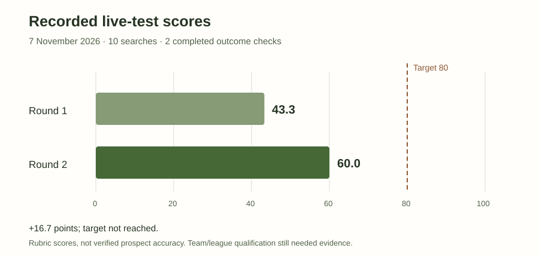
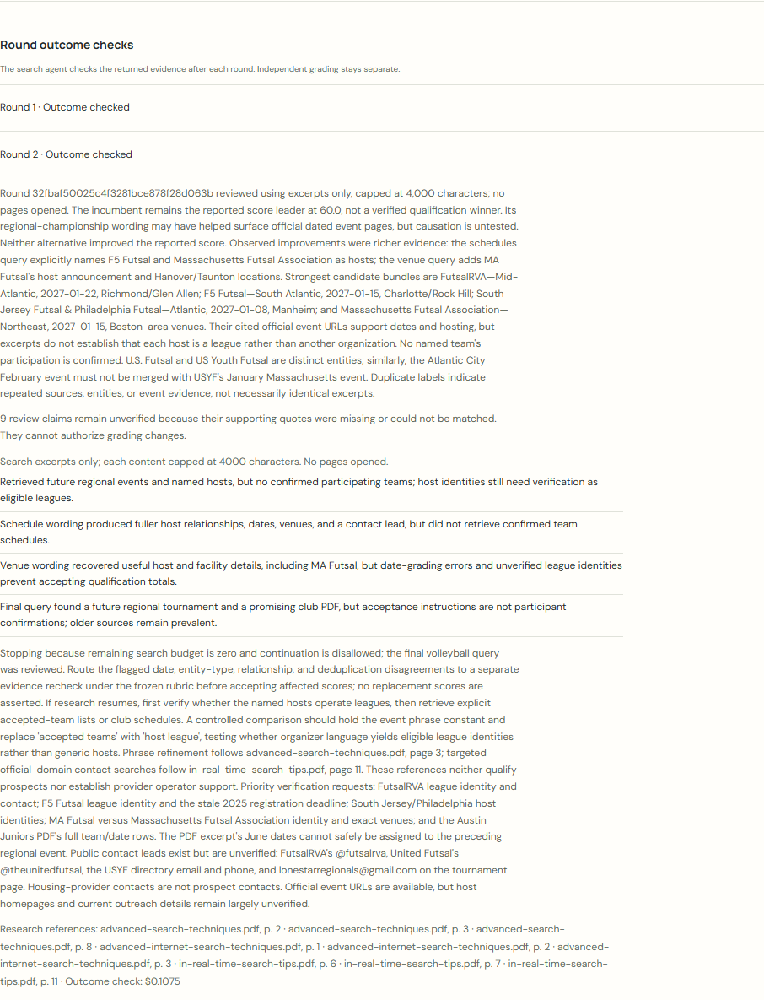

# Querywork

Querywork turns an initial web-search query and a desired outcome into a measurable research experiment. It generates search queries, retrieves results through Tavily, grades evidence independently and improves queries automatically within a user-set budget.

It originated as a research component for Lead Chain. Its core supports general research goals; it is currently a single-user local app, not a hosted commercial service.

## Who it serves

Intended users include lead researchers, research operators and people evaluating retrieval prompts. The commercial target customer remains unvalidated. Users define what would make a result useful; the app measures returned evidence against those requirements.

## How it works

1. Enter a search, desired outcome and mandatory evidence requirements.
2. Set a target score, batch size and total search budget.
3. A search strategist generates queries; Tavily retrieves results.
4. An isolated grader evaluates the returned evidence against the fixed rubric.
5. The strategist's outcome reviewer checks actual results and identifies gaps.
6. The next batch tests controlled variations around the strongest query. Continue until the target or budget is reached; keep history and the best independent score.

The three AI responsibilities are strategist, independent grader and outcome reviewer. They use separate calls, and the reviewer cannot overwrite grades. Supported disputes trigger an isolated recheck. Unverified quotations are flagged rather than accepted.

## Current capabilities

- Local React/TypeScript workbench, FastAPI backend and SQLite history.
- Environment page for locally saved provider keys; validation and configurable models/rates.
- Versioned four-part prompts: role, task, guidelines and examples.
- Research-reference passages from three supplied search guides.
- Automatic batches, incumbent retention, budgets, cancellation and resumable evidence.
- Round outcome reviews, evidence quotes, warnings and next-test feedback.
- JSON/CSV exports, HTTP API, MCP adapter and Windows setup/launcher.

## Latest measured outcome

The 7 November 2026 test completed ten searches in two rounds. Batch-best scores rose from 43.3 to 60; the target was 80. Final self-review still identified missing proof of league identity and named-team participation. These are rubric scores, not verified lead accuracy. The recorded upgrade passed 23 regression tests, a production build and desktop/mobile checks.

See [the detailed report](RESEARCH-UPGRADE-TEST.md), [major changes](CHANGELOG.md), and [the complete project handoff and to-do list](notes.txt).

## Screenshots

These show the saved November 2026 app, not a new live search.

[Mobile outcome review](docs/screenshots/outcome-review-mobile.png) · [Automatic-run setup](docs/screenshots/automatic-improvement-setup.png)

## Next priorities

Strengthen semantic date/entity checks and deduplication, extract unique prospects, verify full pages where needed, build a human-labelled benchmark, and validate the customer before hosted productization.

## Update policy

Every major change must update notes.txt, this overview and CHANGELOG.md with behavior, evidence, limitations and next tasks. Preserve prompt versions and historical measurements. Publish source without credentials or private experiment data.
