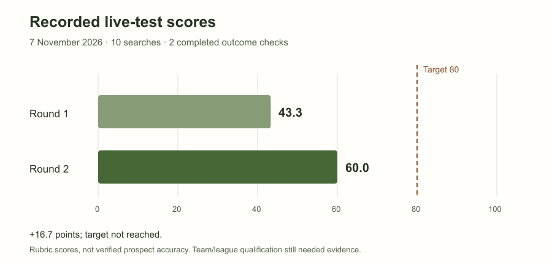

# Querywork - local web-search evaluations and automatic refinement

Querywork tests whether search queries retrieve the evidence a user actually needs. Start with an initial query, describe the desired outcome, define mandatory requirements, and let the app generate, search, grade, review and refine within a budget.

It began as a research component for Lead Chain. It is currently a single-user local website, not a hosted SaaS product or an automatic outreach service.

## Read this project in order

1. **This README:** what runs, how to install/configure it, and how to use it safely.
2. **[notes.txt](notes.txt):** complete plain-text handoff plus the whole-workspace inventory, for someone taking over without the original chat.
3. **[Technical handoff](docs/TECHNICAL-HANDOFF.md):** the same detailed narrative in Markdown, with architecture, every major code path, design decisions, experiments, failures and next work.
4. **[PROJECT.md](PROJECT.md):** product overview, scope and current priorities.
5. **[CHANGELOG.md](CHANGELOG.md):** major-update history and links to historical test reports.
6. **[AGENTS.md](AGENTS.md):** maintenance requirements for future coding work.

7. **[Whole-workspace inventory](docs/WORKSPACE-INVENTORY.md):** source, original plans, every screenshot, references, helper scripts, private-data file roles and grouped generated/dependency content. The original [October 27 plan](docs/planning/web-search-evals-product-plan-2026-10-27.md) is preserved with a clear implementation-gap map.

The detailed handoff is based on the folder contents and source files, not just the chat. It separates implemented behavior from proposals and explains why each approach was used or replaced. You do not need private local experiment data to understand the design, although exact historical cases cannot be replayed from the source repository alone.

## What the app does

```text
User: original query + desired outcome + must-have evidence + target/budget
  -> search strategist generates alternative queries
  -> Tavily retrieves up to ten results for each query
  -> isolated grader evaluates supplied excerpts against the fixed rubric
  -> outcome reviewer checks what this round actually found
  -> application compares eligible scores and plans nearby variations
  -> repeat within budget, or stop and show the best available research
```

The user originally wanted better search terms, then requested automatic rounds, winner-focused variations and a self-check of each round's actual outcome. The application now controls those steps explicitly. The model does not execute an unrestricted agent loop or decide its own spending limit.

## Technology and why it is there

| Layer | Technologies | Responsibility |
| --- | --- | --- |
| Website | React, TypeScript/TSX, HTML, CSS, Lucide | Setup forms, history, prompt editor, comparison table, evidence and review displays. |
| Frontend tooling | Node.js, npm, Vite, TypeScript compiler | Dependency installation, development server, type checking and static production build. |
| Backend | Python, FastAPI, Pydantic, Uvicorn | Validated API, configuration, background work and static site serving. |
| Provider boundary | httpx, JSON Schema | Explicit OpenAI/Tavily requests, structured outputs, timeouts and bounded retries. |
| Storage | SQLite with JSON records | Local experiments, prompts, jobs and settings without an external database service. |
| MCP integration | TypeScript, MCP SDK, Zod, tsx | Six stdio tools forwarding to the same local API. |
| Installation | PowerShell and CMD | Windows setup and background launcher. |
| Research references | PDFs and extracted UTF-8 text | Page-labelled guideline passages supplied to the strategist/reviewer. |

Python keeps orchestration and evidence validation inspectable; TypeScript makes UI/tool contracts explicit; SQLite keeps the prototype local. The tradeoffs are a single worker, JSON-document rather than normalized relational storage, and Windows-specific launcher/test paths. No LangChain, AutoGen, external vector database or multi-agent swarm is installed. See the technical handoff for the full dependency and file map.

## Fresh installation on Windows

Prerequisites: Python 3.12+ and Node.js 22+ with npm. Use model IDs and provider access available to your own accounts; the historical model names in this project do not guarantee current availability.

```powershell
git clone https://github.com/techpulse0000-hub/querywork.git
cd querywork
powershell -ExecutionPolicy Bypass -File .\Setup.ps1
powershell -ExecutionPolicy Bypass -File .\Launch.ps1
```

Setup.ps1 creates .venv, installs requirements.lock.txt, runs npm ci and builds dist/. Launch.cmd is a double-click alternative after setup. Launch.ps1 checks the identity of the service on port 8766 before starting Uvicorn hidden. The browser opens at **http://127.0.0.1:8766/**. Use -NoBrowser to start without opening another tab.

The original workspace also has an unrelated service on port 8765. Do not stop or modify it. If you need foreground diagnostics:

```powershell
.venv/Scripts/python.exe -m uvicorn backend.app:app --host 127.0.0.1 --port 8766
```

Demo mode needs no provider keys. Its example.com sources and deterministic scores are fictional fixtures. A successful demo proves application behavior, not real search accuracy.

## Live configuration

Open **Environment** at http://127.0.0.1:8766/environment, enter OpenAI/Tavily keys and model IDs, save, then validate the connections. Blank secret fields preserve saved keys. Persistent settings are written to local .env; session settings can be applied without storing those session secrets.

Alternatively:

```powershell
Copy-Item .env.template .env
```

Fill OPENAI_API_KEY, TAVILY_API_KEY, GENERATOR_MODEL and GRADER_MODEL locally, then restart when editing the file manually. The legacy local .env.example is intentionally excluded because it previously held real credentials. **Use the published blank .env.template instead.**

Keys remain server-side and are excluded from configuration responses and experiment exports. Configuration changes are rejected while jobs run. Live operations require validation tied to a configuration fingerprint. Validation checks access/authentication; it does not validate model judgment or guarantee all subsequent structured requests succeed.

The historical latest test used gpt-6.1-sol for generation and review, and gpt-4o-mini for isolated grading. Generation used high reasoning, review medium reasoning. Special reasoning settings and pricing are coded for the Sol model specifically, not generalized to every selectable model. Review account support and prices before changing models. PRICING.md is a dated historical configuration, not a live quote.

## Run an experiment

1. Enter the original query and the desired outcome. These are different inputs: the first is what someone would type, the second describes useful evidence.
2. Add mandatory requirements. Be explicit about entity type, relationship, geography, dates and the meaning of words such as major.
3. Choose demo or live mode. For a paid check, start with a small explicit budget.
4. Set target, five or ten new terms per batch, and total search budget, then select **Run automatic improvement**.
5. Inspect both the comparison table and **Round outcome checks**. Expand returned evidence and requirement quotations rather than trusting the aggregate score or summary alone.
6. Export JSON for the full case. CSV is a result-oriented projection, not the complete review history.

Defaults are target 90, five generated queries and 100 logical searches, but these are controls rather than promised outcomes. There is no default five-round handoff. An optional max_rounds cap is exposed through the HTTP API.

The first automatic round also includes the original baseline. A five-query first batch can therefore use six searches. New search budgets count that baseline and any newly searched older budget-skipped queries. Reuse of saved evidence, regrading, generation, reviews and provider retries have separate cost implications: **a search-query budget is not a dollar spending limit**.

Manual mode still supports the original plus three alternatives and up to two explicit refinements. It is useful for controlled comparisons and edits. Automatic per-round self-review belongs to the optimize flow; manual run/regrade does not currently provide that same review loop.

## What makes a new batch different

The generator receives evidence gaps, strong/weak examples, recent candidates, already-tried queries and the latest outcome review. It uses concise source-language wording and separates discovery from verification.

The winner-focused policy gives a fresh incumbent an all-local batch. After one stalled batch, five-query allocation becomes four local plus one nearby; after two or more, three local plus two nearby. Ten-query batches use eight/two and six/four. The aim is to investigate why a score jumped instead of abandoning the useful source family. A strictly higher eligible independent score replaces the incumbent; ties/losses retain it.

This strategy can stall. Evidence may not exist publicly, and an unreliable rubric can reward the wrong result. Rechecks can change eligibility, so do not interpret best retention as a promise that a displayed score can never be revised.

## Three responsibilities, separate authority

- **Strategist:** generates search queries and retrieval hypotheses. It cannot score unsearched terms.
- **Grader:** sees only the outcome, requirements, evaluation date, duplicate policy and returned result evidence. It does not see query wording, target score, generator reasoning or optimizer history.
- **Reviewer:** checks actual query/results after each automatic round, including the final round. Its findings guide the next batch but cannot overwrite grades.

A supported reviewer disagreement triggers one isolated regrade of the affected query, without sending the reviewer's opinion to the grader. An unresolved criterion dispute holds that query out of best acceptance. Unsupported reviewer quotes are removed and marked incomplete/unverified; unsupported disputes do not authorize score changes. Narrative review text is still advisory and can overstate facts, so warnings matter.

A failed review stops further batches. Retrying automatic improvement checks saved evidence before making new searches. Cancellation is checkpoint-based and may wait for an in-flight provider call. Restarted jobs are marked interrupted, not silently resumed into paid work.

## Score meaning and evidence limits

Results are graded 0-3: irrelevant/hard failure/duplicate, background, plausible but incomplete, or fully supported outcome match. Each mandatory requirement is pass/fail/unknown with an exact supporting excerpt. A hard fail forces zero; unknown evidence caps a result at two.

```text
score = round(100 * sum(up to ten result grades) / 30, 1)
```

Missing result positions and identified duplicates contribute zero. Score 70 can mean seven fully supported results, or a mix of partial/background results totaling 21 points. It is not verified lead accuracy, purchase probability or web-wide recall. One source listing many prospects still occupies one URL slot.

Normal grading uses search content capped at 16,000 characters/result; outcome review uses up to 4,000. The app does not open full pages automatically. Exact quote validation proves text presence, not correct interpretation. Date/entity errors, alias duplicates and mismatches between model summary prose and adjusted structured counts remain known issues.

## What happened in the tests

The latest recorded live test is **7 November 2026**, not a new run performed by reading this README:

- Ten actual searches over two rounds; 100 returned-result checks.
- Batch-best scores 43.3 then 60; target 80 was missed.
- Both outcome reviews completed, and the first fed the next batch.
- Known estimated usage cost $0.811617 including recoverable failed-review usage; timed-out calls may have additional unreported charges.
- The final review still lacked proof that some hosts were leagues and did not confirm named-team participation. The score is not a verified prospect list.
- Recorded verification: 23 regression tests, production build and desktop/mobile checks passed.



Earlier approaches tested cheaper models, stronger generation, changed prospect definitions, broad pivots and winner-focused local variants. Their goals/rubrics/dates differ. The full handoff explains why these experiments are not a controlled model leaderboard and why the earlier nominal 70 does not make the later 60 a direct regression.

See [SOL-BENCHMARK.md](SOL-BENCHMARK.md), [UPCOMING-TOURNAMENTS-TEST.md](UPCOMING-TOURNAMENTS-TEST.md), [WINNER-STRATEGY-TEST.md](WINNER-STRATEGY-TEST.md) and [RESEARCH-UPGRADE-TEST.md](RESEARCH-UPGRADE-TEST.md). Some historical links refer to private data/ files absent from GitHub by design.

## Code and data orientation

Read backend/app.py for API/persistence, engine.py for providers/evidence validation, optimizer.py for the automatic loop, search_strategy.py for allocation, search_prompts.py for prompts, research.py for PDF text selection, and round_review.py for self-checks. src/main.tsx owns the workbench; Optimization.tsx and RoundReviews.tsx show the loop and reviews. mcp/server.ts forwards tools to the local API.

SQLite stores JSON records in data/querywork.sqlite3 using records(kind,id,body). Prompt, experiment, job and settings records preserve the working history. data/api-token protects local API/MCP access. Set QUERYWORK_DATA before startup to use another directory. Back up data/ and .env privately; neither is distributed in the repository.

The supplied PDFs and extracted text are in references/search-guides/. The app selects page-labelled passages and records extraction hashes. This is lightweight lexical selection, not embeddings or unrestricted PDF browsing. Special query operators are not assumed supported merely because an older guide describes them. Third-party authorship and redistribution rights remain with the sources.

## HTTP API and MCP

Interactive schema: http://127.0.0.1:8766/docs. Routes under /api/v1 cover configuration/validation, prompts, experiment creation/history, query editing, generate/run/refine/regrade/optimize, job polling/cancellation and JSON/CSV export. See the full route table and record fields in the technical handoff.

Long-running actions return HTTP 202 plus a job ID. Supply an idempotency_key for each intended operation and poll /jobs/{id}. Reusing the same key retrieves the previous intended submission; a new key requests another operation. API clients use Authorization: Bearer with the local token; the same-origin UI uses an HttpOnly SameSite cookie.

The stdio MCP adapter exposes create_experiment, generate_terms, run_experiment, get_experiment, refine_experiment and optimize_experiment. Start the local service first. A host configuration is:

```json
{
  "mcpServers": {
    "querywork": {
      "command": "C:/Program Files/nodejs/node.exe",
      "args": ["C:/ABSOLUTE/APP/node_modules/tsx/dist/cli.mjs", "C:/ABSOLUTE/APP/mcp/server.ts"]
    }
  }
}
```

Replace installation paths. QUERYWORK_URL and QUERYWORK_TOKEN are adapter overrides. The HTTP optimize endpoint currently exposes more prompt/feedback selection controls than the MCP optimize tool schema.

## Development, verification and recovery

```powershell
.venv/Scripts/python.exe -m pytest tests/test_app.py -q
npm run build
npm run test:mcp
```

The MCP smoke check needs the service running. npm run dev starts Vite with an /api proxy to 8766; establish local backend authentication or use the built same-origin UI for complete access testing.

Historical live/browser scripts may contain absolute Windows runtime paths, saved experiment IDs and pinned dates. Inspect and adapt them before running on a fresh clone. In particular, tests/research_live_test.py is a specific paid benchmark/recovery harness, not a generic safe startup command. No new paid calls are required for documentation changes.

If the app fails to launch, check dist/index.html and service identity on port 8766. If validation fails, check keys/account model access without publishing them. If a job fails, inspect the saved stage/evidence before retrying. If a run stalls, separate poor retrieval, missing public evidence, grading error and provider failure; do not fix every problem by increasing the query budget.

## Limitations and next steps

Highest priorities: semantic date/entity validation, canonical deduplication, explicit provisional/reviewed acceptance states, unique prospect extraction, fuller evidence verification and a human-labelled benchmark. Then improve pricing/cost ceilings, latency, portable test harnesses and reference selection.

A public hosted product additionally needs authentication, tenant isolation, secure credential storage, owned jobs, scalable workers, rate limits, billing and monitoring. Binding to loopback and checking a local token do not provide those capabilities.

## Repository and maintenance

Private repository: https://github.com/techpulse0000-hub/querywork. Source uploads exclude .env variants except the blank template, local tokens/data, dependencies, build output, caches and scratch files. Do not publish private backups or assume privacy grants a license to the reference PDFs.

After each major change, update the project summary, notes, changelog and relevant setup/behavior documentation together. Preserve historical prompt versions, outcomes and date cutoffs. Record what changed, why, which alternatives were considered, tests actually run, measured outcomes, known limits and next tasks. Edit docs/TECHNICAL-HANDOFF.md and docs/WORKSPACE-INVENTORY.md, then run `python tools/sync_handoff.py` to regenerate notes.txt from both documents. Review new folder artifacts as well as the chat history.
